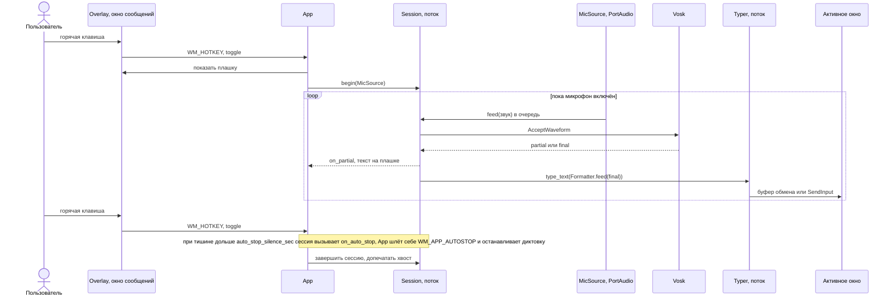
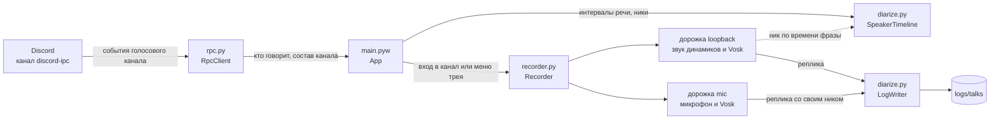
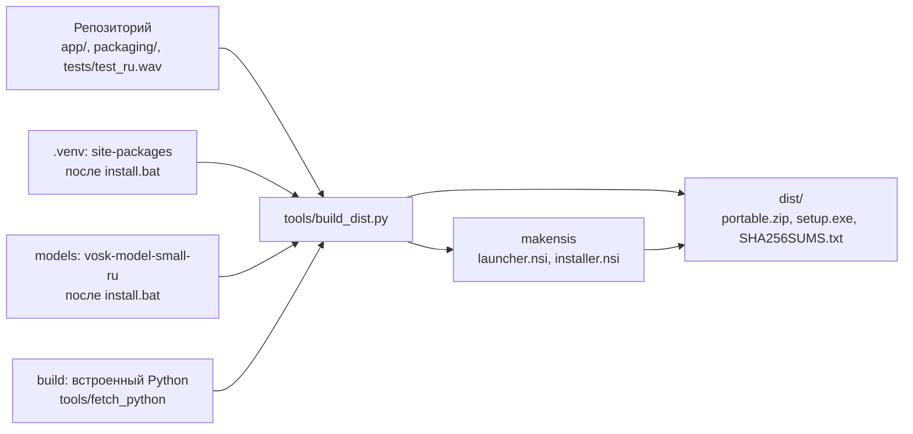

# Архитектура

Vosk Dictation — локальное приложение для Windows. Нажатие горячей клавиши включает микрофон, Vosk распознаёт речь, текст вставляется в активное окно. Отдельный режим записывает разговор из Discord в текстовый лог с подписью реплик никами. Распознавание идёт на компьютере пользователя; в сеть приложение ходит только за OAuth-токеном Discord, модель скачивается при установке.

## Компоненты

```mermaid
flowchart TB
    subgraph UI["Интерфейс, главный поток (Win32)"]
        HK["hotkey.py<br/>глобальная горячая клавиша"]
        OV["overlay.py, painter.py<br/>плашка и цикл сообщений"]
        TR["tray.py<br/>значок в трее и меню"]
    end

    APP["main.pyw, App<br/>оркестратор, одна копия"]
    CFG[("config.json<br/>config.py")]

    subgraph DICT["Диктовка"]
        ENG["engine.py<br/>MicSource, Session, ModelHolder"]
        TP["textproc.py<br/>Formatter"]
        TY["typer.py<br/>Typer, ClipboardPaster"]
    end

    subgraph TALK["Запись разговора"]
        REC["recorder.py<br/>Recorder, дорожки"]
        DZ["diarize.py<br/>SpeakerTimeline, LogWriter"]
        RPC["rpc.py<br/>RpcClient"]
    end

    HK -->|WM_HOTKEY| OV
    TR -->|команды меню| APP
    OV <-->|оконные сообщения| APP
    APP --> CFG
    APP --> ENG
    ENG --> TP
    TP --> TY
    APP --> REC
    REC --> DZ
    RPC -->|кто говорит, состав канала| APP

    ENG --> VOSK[("Модель Vosk")]
    REC --> VOSK
    ENG -.-> MIC["Микрофон, PortAudio"]
    REC -.-> LOOP["Динамики (loopback) и микрофон"]
    TY -.-> WIN["Активное окно, буфер обмена"]
    RPC -.-> DISCORD["Discord, канал discord-ipc"]
```

- Единая точка входа событий — `App.on_message` в цикле сообщений главного потока. Горячие клавиши, команды трея, события Discord и сигналы фоновых потоков приходят туда как оконные сообщения (`overlay.post`).
- Win32 сосредоточен в `winapi.py` (ctypes-обёртки), `overlay.py`, `hotkey.py`, `typer.py`, `tray.py`. `textproc.py`, `painter.py`, `diarize.py`, `config.py` от Windows не зависят и тестируются отдельно; в `rpc.py` транспорт (`PipeTransport`) отделён от логики протокола.
- Источник звука подставляется в `Session`: микрофон или wav-файл (для `--wav` и тестов).

## Диктовка

- Распознавание идёт в отдельном потоке `session-N`; звук приходит из потока PortAudio через `queue.Queue`.
- Ввод текста — отдельный поток `typer` с очередью. Текст не печатается, пока зажаты Ctrl, Alt, Shift или Win.
- Способ ввода выбирается по активному окну (`typing_method`, `per_app_typing`): вставка через буфер обмена с отложенной отрисовкой (прежнее содержимое буфера возвращается) или посимвольный SendInput.

## Запись разговора

- Две независимые дорожки: звук динамиков (собеседники) и микрофон (свой голос). У каждой свой поток и свой распознаватель Vosk.
- Discord сообщает, кто и когда говорил. Фразе собеседников назначается ник того, чья речь сильнее всего пересекается с ней по времени.
- Если Discord закрыт или перезапущен, супервизор в `App` пересоздаёт RPC-клиент.
- Вход в голосовой канал может сам начать запись (`talk_autostart_on_channel`).

## Потоки

| Поток | Назначение |
|---|---|
| Главный | цикл сообщений Win32 (`Overlay.run_loop`), обработчик `App.on_message` |
| `session-N` | распознавание Vosk и форматирование одной диктовки |
| PortAudio | callback микрофона, кладёт звук в очередь сессии |
| `typer` | очередь текста, ввод в активное окно |
| загрузка модели | `ModelHolder.load_async`, по готовности сообщение `WM_APP_MODEL` |
| pystray | значок и меню в трее, команды уходят в главный поток через `post_*` |
| `track-loopback`, `track-mic` | дорожки записи разговора |
| `rpc-sup`, `RpcClient`, `rpc-reader` | Discord RPC: супервизор, клиент, чтение кадров |

## Интеграции и границы

| Граница | Через что |
|---|---|
| Windows | `ctypes` (`winapi.py`): окна, горячие клавиши, SendInput, буфер обмена; реестр для автозапуска |
| Микрофон | `sounddevice` (PortAudio) |
| Звук динамиков | `soundcard` (loopback) |
| Распознавание | `vosk` (Kaldi), модель в `models/` |
| Discord | локальный именованный канал `discord-ipc-N`; HTTPS к `discord.com/api/oauth2/token` для обмена и обновления токена |
| Плашка | `Pillow` рисует кадр, `overlay.py` показывает его слоёным окном без фокуса, пропускающим клики |

## Каталоги

| Путь | Назначение |
|---|---|
| `app/` | исходники приложения; `app/assets/` — значок и звуки |
| `tests/` | unit-скрипты и `test_ru.wav` для самопроверки |
| `tools/` | сборка дистрибутива, загрузка встроенного Python, проверка установщика, генерация ассетов, проба Discord |
| `packaging/` | сценарии NSIS (установщик и запускатель); `packaging/dist/` — файлы, которые кладутся в корень дистрибутива |
| корень | сценарии установки, запуска и диагностики для пользователя (`install.*`, `restart.bat`, `diagnose.bat` и др.), `requirements.txt` |
| не в git | `.venv/`, `models/`, `logs/` (`app.log`, `talks/`), `build/`, `dist/`, `config.json` |

## Установка и сборка

- Установка из исходников: `install.bat` запускает `install.ps1` — окружение `.venv`, зависимости, модель Vosk, проверка на `tests/test_ru.wav`, ярлыки, автозапуск.
- Дистрибутив: `tools/build_dist.py` собирает переносимый zip и установщик (NSIS) из `app/`, пакетов `.venv`, встроенного Python и модели.
